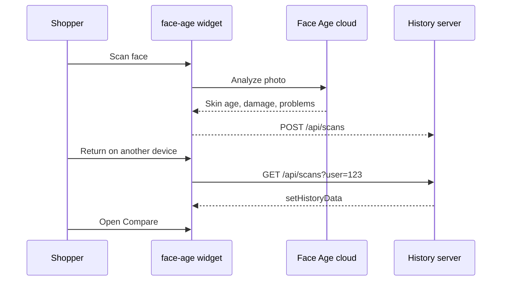

<p>
  
</p>

# Face Age Scan History Server

Self-hosted scan history for the [face-age](https://www.npmjs.com/package/face-age) skin analysis SDK. Stores each shopper's skin age, skin health, and problem scores on your own server, then feeds them back so the widget can show past scans and the Compare tab on any device.

[Face Age](https://getfaceage.com/) runs the analysis in the browser widget and the Face Age cloud. This Node.js service does not analyze photos. It only keeps the result payload, encrypted at rest, with a delete and export path for privacy requests.

Built for stores and developers who embed face-age and want cross-device skin scan history without standing up their own backend.

## Features

- REST API to create, list, and delete face-age scans
- SQLite by default, PostgreSQL when `DATABASE_URL` is a Postgres URL
- API key authentication (`X-Api-Key` or `Authorization: Bearer`)
- Browser helper that syncs `API.getAdvisorData()` and restores history with `API.setHistoryData()`
- Per-user export and a GDPR-style delete that erases every scan for that user id
- AES-256-GCM encryption at rest
- Retention window and a per-user scan cap
- Facial photos are dropped before storage
- Docker image and Compose file
- OpenAPI docs at `/docs`

## How it works

Face Age cannot run in Node. The shopper's browser loads the widget, the widget talks to the Face Age cloud, and this server stores the JSON result.

1. Run `docker compose up`. The history server listens on port 3000.
2. On your site, after a scan, a short snippet posts `API.getAdvisorData()` output to `POST /api/scans` with the logged-in user's id.
3. When that user returns on another device, the snippet calls `GET /api/scans?user=123` and passes the saved results to `API.setHistoryData()`.
4. The widget opens past scans and its Compare tab. `analyze_ref_token` is the dedupe key, so posting the same scan again updates the existing row.
5. A privacy delete is `DELETE /api/users/123`, which removes everything stored for that user.



## Quick start

Requirements: Docker, or Node.js 20.

### Docker

```bash
cp .env.example .env.local
# Set API_KEY, DATA_ENCRYPTION_KEY, and FACEAGE_CLIENT_ID
docker compose up --build
```

Open [http://localhost:3000](http://localhost:3000) for the demo (widget + helper) and [http://localhost:3000/docs](http://localhost:3000/docs) for the API docs.

PostgreSQL instead of SQLite:

```bash
docker compose -f docker-compose.postgres.yml up --build
```

### Node.js

```bash
cp .env.example .env.local
npm install
npm run build
npm start
```

`npm run dev` rebuilds the database schema and restarts on file changes.

## Configuration

Environment variables are read from the process environment. For local development, put them in `.env.local` (gitignored) or `.env`. Never commit secrets.

| Variable | Default | Purpose |
| --- | --- | --- |
| `API_KEY` | required | Secret sent by your site or the browser helper. Comma-separated values are accepted. `API_KEYS` is an alias. |
| `DATA_ENCRYPTION_KEY` | required | Password for AES-256-GCM encryption of every stored payload. At least 16 characters. |
| `DATABASE_URL` | `file:./data/history.db` | SQLite file or a `postgresql://` URL. |
| `PORT` | `3000` | HTTP port. |
| `HOST` | `0.0.0.0` | Bind address. |
| `RETENTION_DAYS` | `365` | Delete scans older than this many days. `0` keeps them until you delete them. |
| `MAX_SCANS_PER_USER` | `50` | After a new save, older scans beyond this count are deleted. |
| `MAX_PAYLOAD_BYTES` | `200000` | Maximum JSON size after image removal. |
| `STORE_IMAGES` | `false` | When `false`, facial image fields and `meta.image` are removed. `https` product image URLs are kept so restored recommendations can still render. |
| `CORS_ORIGIN` | `*` | Comma-separated browser origins allowed to call the API. Set this to your store domain before a public deploy. |
| `DEMO_ENABLED` | on outside production | Serves the widget demo at `/`. Turn it off on a public server so the API key is not written into HTML. |
| `FACEAGE_CLIENT_ID` | empty | Client ID used only by the demo page. |
| `RATE_LIMIT_MAX` | `120` | Requests per minute per IP. |
| `LOG_LEVEL` | `info` | Pino log level. |

### Getting a Client ID

The history server does not call Face Age on your behalf. The widget does, and the widget needs a Client ID (`faceageId`).

1. Open [panel.getfaceage.com](https://panel.getfaceage.com/) and create an account.
2. Copy the Client ID from the panel.
3. Pass it to `new FaceAge({ faceageId: 'YOUR_CLIENT_ID' })` on your site.
4. For this repo's demo page, set `FACEAGE_CLIENT_ID` in `.env.local` and restart. Do not commit the value.

The widget mounts directly in the page, in an element with id `FaceAge-module`. It is not iframed by your code. face-age 2.4.x returns skin age, a skin health / damage percentage, and 13 problem scores. It does not return real age or gender.

## Browser helper

The helper is published in the browser as `FaceAgeHistory` from `/face-age-history.js`, and it can be imported from this package as `face-age-history-server/helper`.

Call `attach` before `render`. The widget reads history while it renders, and a later `setHistoryData` call would miss that first paint.

```html
<div id="FaceAge-module"></div>
<script src="https://cdn.jsdelivr.net/npm/face-age@2.4.13/dist/faceage.js"></script>
<script src="https://history.example.com/face-age-history.js"></script>
<script>
  const faceAge = new FaceAge({
    elementId: 'FaceAge-module',
    faceageId: 'YOUR_CLIENT_ID',
    history: true,
  });

  FaceAgeHistory.attach(faceAge, {
    baseUrl: 'https://history.example.com',
    apiKey: 'YOUR_API_KEY',
    userId: '123',
  }).then(() => faceAge.render());
</script>
```

What the helper does:

- Registers `API.getAdvisorData()`. When a scan finishes, it posts the result to `/api/scans`.
- On load, fetches `GET /api/scans?user=123` and calls `API.setHistoryData()` once with every saved scan.
- Wraps `API.removeHistoryItem(token)` so a local delete also deletes that scan on the server. `removeHistoryItem(null)` deletes the user.

face-age 2.4.13 replaces its in-memory history on every `setHistoryData` call. Sending scans one by one would leave only the last scan, and Compare would have nothing to compare. The helper therefore sends one history document:

```js
{
  latestRefId: 'analyze_ref_newer',
  updatedAt: 1710000000000,
  items: {
    analyze_ref_older: { analysis, activeSelections, meta },
    analyze_ref_newer: { analysis, activeSelections, meta }
  }
}
```

That shape is what the 2.4.13 widget reads (`items` plus `latestRefId`) for the history gate, the Compare tab, and `removeHistoryItem(token)`.

### Payload shape

Documented `getAdvisorData` callback:

```js
{
  analysis: {
    analyze_ref_token: 'analyze_ref_abc123',
    skinAge: 28,
    damagePercentage: 12.4,
    problems: [{ key: 'pores', title: 'Pores', number: 22 }]
  },
  activeSelections: { skinType: 'combination' }
}
```

In the published 2.4.13 build, `getAdvisorData` is invoked with the problems array as `analysis`, while `analyze_ref_token`, `skinAge`, and `damagePercentage` live on the widget report object. The helper merges that callback with `faceAge.w.globals.skinAnalyzeData` so the stored record still has a real dedupe token. If no token can be found, the scan is not uploaded.

`meta.ts` is a millisecond timestamp. `meta.quality` may include `lightingScore`, `lighting`, `brightness`, `sharpnessScore`, `sharpness`, `blur`, `noise`, and `confidence` as finite numbers from 0 to 100. The helper does not send `meta.image` unless you pass `includeImage: true`, and even then only for `http` or `https` URLs.

The API key is visible to the browser. Lock `CORS_ORIGIN` to your store, and treat the key as a rotatable integration secret. For a stricter setup, proxy these routes through your backend and keep the key there.

## API reference

Interactive docs: `/docs`. Machine-readable spec: `/openapi.json`.

All `/api/*` routes require `X-Api-Key: <API_KEY>` or `Authorization: Bearer <API_KEY>`.

### Create or update a scan

`POST /api/scans`

```bash
curl -X POST http://localhost:3000/api/scans \
  -H "X-Api-Key: $API_KEY" \
  -H "Content-Type: application/json" \
  -d '{
    "userId": "123",
    "payload": {
      "analysis": {
        "analyze_ref_token": "analyze_ref_abc123",
        "skinAge": 28,
        "damagePercentage": 12.4,
        "problems": []
      },
      "activeSelections": { "skinType": "combination" },
      "meta": { "ts": 1710000000000 }
    }
  }'
```

Returns `201` when the token is new for that user and `200` when the same `analyze_ref_token` is updated. `user` is accepted as an alias of `userId`.

### List scans

`GET /api/scans?user=123`

Newest first. Optional `limit` (1–100, default 50) and `offset`.

### Delete one scan

`DELETE /api/scans/:id`

`DELETE /api/scans?user=123&token=analyze_ref_abc123`

### Export a user

`GET /api/users/123/export`

Returns every stored scan for that id as JSON.

### Delete a user

`DELETE /api/users/123`

Removes every scan stored for that id. Response: `{ "userId": "123", "deleted": 4 }`. Deleting a user that has no rows returns `deleted: 0`.

### Health

`GET /health` returns `{ "status": "ok" }` and does not require an API key.

## Privacy

- Payloads are encrypted with AES-256-GCM before they are written. The database stores ciphertext.
- `basCode`, data URLs, and other embedded facial image fields are removed before encryption. This service never stores the camera photo unless you opt in with `STORE_IMAGES=true`, and even then only an `http` or `https` `meta.image` URL is eligible. The raw base64 capture is always dropped.
- `RETENTION_DAYS` deletes old rows on a schedule and whenever scans are read or written. `MAX_SCANS_PER_USER` drops the oldest rows past the cap.
- `GET /api/users/:userId/export` and `DELETE /api/users/:userId` are the access and erase endpoints for a store user id.
- Logs redact the API key header. Request bodies are not logged.
- Analysis still happens in the shopper's browser and in the Face Age cloud, under Face Age's own terms. This repository only covers the history copy you choose to keep.

## FAQ

### Does this server run face-age or analyze faces?

No. The face-age package is a browser widget. Photos are analyzed by the widget and the Face Age cloud. This process only stores and returns the result JSON.

### What is stored for each scan?

The advisor payload: skin age, damage percentage, problem scores, quiz selections (`activeSelections`), and optional routine or product metadata. The dedupe key is `analysis.analyze_ref_token`.

### How does the Compare tab get its data?

The helper restores every saved scan through `API.setHistoryData()` before `render()`, with `history: true` on the widget. Opening a past analysis in the widget exposes Compare.

### Can two devices share history?

Yes. Use the same store user id on both devices. The history lives in this server, not in `localStorage`.

### How do I erase a shopper?

`DELETE /api/users/{userId}` with your API key. That deletes every scan for that id.

### Where do I get a Client ID?

Create one at [panel.getfaceage.com](https://panel.getfaceage.com/). Put it in the widget's `faceageId` option. For the local demo, set `FACEAGE_CLIENT_ID` in `.env.local`.

### Which face-age methods does the helper use?

`API.getAdvisorData()`, `API.setHistoryData()`, and `API.removeHistoryItem(token)`, matching face-age 2.4.x.

## License

MIT. Copyright (c) 2026 milad mostafa.

Face Age and the face-age SDK are published at [getfaceage.com](https://getfaceage.com/) and [npmjs.com/package/face-age](https://www.npmjs.com/package/face-age).

Suggested GitHub topics: `face-age`, `skin-analysis`, `skin-age`, `scan-history`, `face-scan`, `skincare`, `beauty-tech`, `self-hosted`, `gdpr`, `fastify`, `sqlite`, `openapi`.
